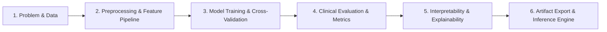

# Heart Disease Risk Prediction - End-to-End ML Pipeline

## Overview
An end-to-end Machine Learning pipeline for predicting heart disease risk (High Risk vs. Low Risk) based on clinical and physiological markers (age, sex, resting BP, serum cholesterol, fasting blood sugar, resting ECG, maximum heart rate, exercise angina, ST depression, etc.).

---

## Architecture & Workflow



### 1. Problem Formulation & Data Exploration (EDA)
- **Objective:** Clinical risk stratification to flag high-risk cardiovascular cases for timely interventions.
- **Dataset:** UCI Heart Disease clinical feature set.
- **Data Integrity:** Plausibility validation (non-zero physiological measurements), anomaly screening, and target distribution evaluation.

### 2. Preprocessing & Feature Engineering
- **Leak-Proof Preprocessing:** Scikit-Learn `ColumnTransformer` and `Pipeline` fit exclusively on training data.
- **Numerical Pipeline:** Median imputation + standard scaling.
- **Categorical Pipeline:** One-hot encoding (`handle_unknown='ignore'`) / ordinal encoding where clinically relevant.
- **Splitting:** Stratified train/test splits (80/20) preserving disease prevalence.

### 3. Model Training & Comparison
- **Logistic Regression (L2 Regularized):** Interpretable clinical baseline.
- **Random Forest Classifier:** Tree ensemble capturing non-linear interactions and threshold boundaries.
- **Gradient Boosting (e.g., XGBoost / LightGBM / HistGradientBoosting):** High-performance non-linear predictive benchmark.
- **Validation:** 5-Fold Stratified Cross-Validation.

### 4. Clinical Model Diagnostics & Evaluation
- **Sensitivity / Recall:** Prioritized to minimize false negatives (preventing missed diagnoses).
- **ROC-AUC & PR-AUC:** Balanced performance assessment under class imbalances.
- **Brier Score & Calibration:** Assessing reliability of predicted probabilities.
- **Threshold Optimization:** Tuning decision cut-offs for target sensitivity targets (e.g., > 90%).

### 5. Explainability & Interpretability (XAI)
- **Global Feature Importance:** Permutation importance and feature weight inspections.
- **Local Interpretability:** Patient-level feature attributions to provide clinicians with rationale for risk predictions.

### 6. Serialization & Inference
- Model artifact serialization via `joblib`.
- Standalone inference interface for scoring novel patient data payloads.

---

## Project Structure
```text
ml_workflow_mid2/
├── README.md
├── task.md
├── pyproject.toml
├── .antigravityrules
├── .gitignore
├── src/
│   ├── data/
│   ├── features/
│   ├── models/
│   └── inference/
## How to Run

### 1. Run the End-to-End Pipeline
Executes data ingestion, stratified 5-fold cross-validation benchmarking, model training, clinical threshold optimization, feature attribution, and artifact serialization:
```powershell
python main.py
```

### 2. Launch the Streamlit Web Application
Starts the interactive clinical decision support web dashboard:
```powershell
streamlit run app.py
```

### 3. Run the Test Suite
Runs all unit and integration tests across data loading, preprocessing, model training, evaluation, explainability, and inference:
```powershell
python -m pytest -q
```

### 3. Run the Linter
Validates PEP 8 compliance and code quality in errors-only mode:
```powershell
python -m ruff check --quiet
```

### 4. Standalone Patient Risk Inference
To score novel patient records using the serialized artifact in Python:
```python
from src.inference.predict import ClinicalRiskPredictor

# Load the trained artifact
predictor = ClinicalRiskPredictor("artifacts/heart_disease_pipeline.joblib")

# Input patient clinical measurements
patient = {
    "age": 63.0,
    "sex": 1.0,
    "cp": 1.0,
    "trestbps": 145.0,
    "chol": 233.0,
    "fbs": 1.0,
    "restecg": 2.0,
    "thalach": 150.0,
    "exang": 0.0,
    "oldpeak": 2.3,
    "slope": 3.0,
    "ca": 0.0,
    "thal": 6.0,
}

# Generate risk prediction
result = predictor.predict_patient_risk(patient)
print(result)
```
